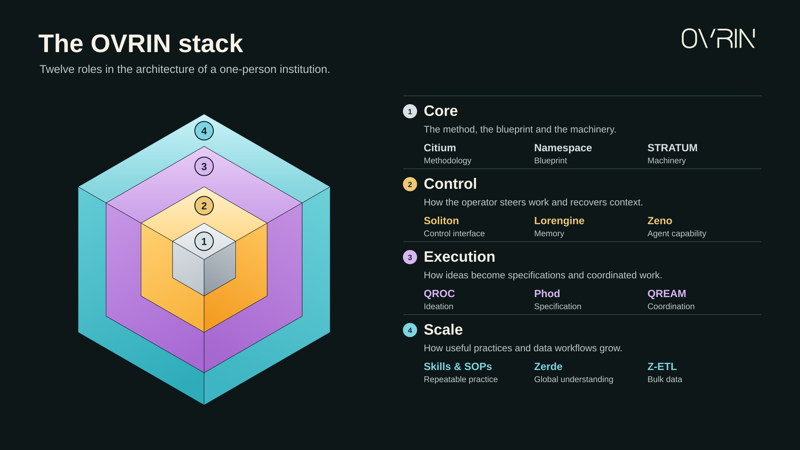

# OVRIN

How does one person keep an institution’s memory, make decisions, and coordinate work without losing the thread between them? OVRIN builds local tools around that question. You can start with a planner, a folder of records, or a single requirement. Each has a useful life on its own.

**[Explore OVRIN Labs](https://ovrinlabs.ca/)** · [Research at Citium](https://citium.ovrinlabs.ca/) · [Data tools at Zavent](https://zaventdata.com/)

The illustration maps the wider system. The repositories below are the first pieces prepared for release. Pick the one closest to a problem you have today.

| If you want to… | Start here | What you can try |
| --- | --- | --- |
| Give a growing project a home | [Namespace](https://github.com/ovrinco/namespace) | Follow a record from source to summary, then catch a misspelled project name. |
| Keep a task attached to its purpose | [Soliton](https://github.com/ovrinco/soliton) | Create a goal and a task, restore the task from trash, and reopen both. |
| Find the record behind an answer | [Lorengine](https://github.com/ovrinco/lorengine) | Retrieve a passage about an irrigation pump and inspect the cited line. |
| Decide whether an idea is ready to advance | [QROC](https://github.com/ovrinco/qroc) | Submit a rough project brief and inspect how the bridge accepts or rejects requests. |
| Carry a requirement into coordinated work | [QREAM](https://github.com/ovrinco/qream) | Prepare a campaign on disk, reopen it, and check that a second creation protects the first. |
| Run and verify repeatable work | [Skills](https://github.com/ovrinco/skills) | Explore twenty adapted skills, from research briefs and project backups to independent acceptance checks. |

## Three ways into the work

**OVRIN Labs** brings the stack together and explains how it grew. **Citium** is where you can read the research and examine the method behind it. **Zavent** is where you can explore the data products that put parts of the stack to work.

For a first visit, start with [the OVRIN site](https://ovrinlabs.ca/). For a first build, choose one repository above and run its smallest example. Each README identifies what that example verifies and what still needs a wider installation test.

[Apache-2.0 license](LICENSE) · [Contributing](CONTRIBUTING.md) · [Report a vulnerability privately](SECURITY.md)
